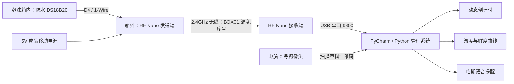

# 海鲜鲜度倒计时标签——重新设计方案

## 1. 最终方案一句话

用真实泡沫箱装海鲜；每只箱子外侧固定一个电池供电的 RF Nano 温度节点，防水探头伸到箱内随箱移动；电脑用第二块 RF Nano 接收温度，用 0 号摄像头扫描草料二维码登记产品，再按温度变化动态计算剩余鲜度、画曲线并语音提醒。

## 2. 为什么选 RF Nano，而不是硬串口或其他无线

| 方案 | 是否适合本项目 | 原因 |
|---|---|---|
| 两块 RF Nano 无线 | **最优，已经采用** | 泡沫箱可自由移动；无需拖线；用户已有板子和 Mixly 示例；电脑端仍能通过 USB 串口稳定接入 Python |
| 发送节点与电脑硬串口直连 | 不推荐作最终展示 | 线会拴住泡沫箱，搬动时易拔线或进水；只适合桌面调试 |
| 蓝牙 | 可做以后版本 | 配对和电脑兼容性会增加现场不确定性，目前没有必要更换现有板子 |
| Wi-Fi/ESP32 | 多箱联网时再考虑 | 能远程联网，但要配置路由器、密码和网络；比赛现场的可控性不如点对点 RF Nano |
| LoRa | 不合适 | 适合远距离低速传输，本项目几十米以内，成本和复杂度没有收益 |

最终链路是“箱端 DS18B20 → RF Nano 无线 → 电脑端 RF Nano → USB 串口 → Python”。RF Nano 的无线频率和地址两端必须完全相同。程序统一使用地址 `FRESH`、频道 `76`、1Mbps、16 位 CRC、32 字节固定载荷。

## 3. 系统结构



## 4. 传感器怎样跟着经常移动的海鲜

最实用的监测单位不是“每一条鱼”，而是“每一只周转箱/这一批产品”。电子盒用魔术贴固定在泡沫箱外壁，探头保护套夹在箱内篮或产品周转袋的中部，所以箱子搬到冷库、车上或展台时，探头和无线节点一起移动。

探头不能贴冰袋、箱壁或箱盖，也不要直接刺进食品。建议放在海鲜中部高度、距冰袋和箱壁约 3–5cm 的位置，用带孔食品级保护套固定。电子件留在外面，原因是箱内会有冷凝水和盐水。

当产品从 `BOX01` 换到 `BOX02` 时，重新生成/扫描包含 `BOX02` 的二维码，系统就把它绑定到新箱的温度。以后若做多箱版本，每箱只需增加一套发送节点，电脑端一个接收器仍可接收，但需给节点安排时隙或不同地址以避免同时发送碰撞。

## 5. 二维码设计

格式：`SEAFOOD|品种|箱号|产品编号`

例：`SEAFOOD|SHRIMP|BOX01|S001`

- 品种：`FISH` 鱼、`SHRIMP` 虾、`CRAB` 蟹、`SHELL` 贝。
- 箱号必须与发送端数据中的 `BOX01` 一致。
- 产品编号必须唯一。同箱多个产品可共用温度，但分别保留自己的倒计时。
- 可直接复制 `qr/草料二维码内容模板.csv` 的文本到草料二维码。

## 6. 倒计时算法

设 4°C 为参考温度，温度老化倍数：

`老化倍数 = 2 ^ ((当前温度 - 4) / 10)`

每次新温度到达后：

`新增等效老化小时 = 实际间隔小时 × 老化倍数`

`剩余小时 = 品种基准小时 - 累计等效老化小时`

同时记录容易向评委解释的超温指标：

`超温度分钟 += max(0, 平均温度 - 4) × 时间分钟`

例：在 14°C 放 1 小时，老化倍数为 2，约消耗 2 小时的“4°C 等效鲜度”；在 9°C 放 10 分钟，超温累积增加 `(9-4)×10=50 度·分`。

Python 对无线断线做保护：两次样本最多累计 10 秒，超过的空白时间不擅自推算；重复序号也不会重复扣减。正常模式按真实时间，演示模式明确显示 1200 倍时间加速。

初始基准值为鱼 48h、虾 36h、蟹 36h、贝 24h，只用于科创原型。答辩时应主动说明：真正参数要通过对照实验标定，本装置不是食品检验仪，也不能据此决定是否食用。

## 7. 两份 Mixly 程序

- `mixly/01_泡沫箱温度发送端_RF-Nano.mix`：读取 D4 的 DS18B20，检查温度有效性，组成 `BOX01,3.75,123`，每秒无线发送。
- `mixly/02_电脑温度接收端_RF-Nano.mix`：收到 32 字节载荷后补结束符，通过 USB 串口逐行交给 Python。

两份都是可在 Mixly 2.0 打开的图形块工程，不是只塞一整段 C++ 的纯代码模式。RF24 库本身在常见 Mixly 面板中没有完整原生积木，因此无线初始化和发送/接收使用少量“代码块”，温度读取、判断、函数、串口和循环仍是可拖拽模块。

## 8. Python 管理系统

PyCharm 打开 `python_app`，安装 `requirements.txt` 后运行 `app.py`。功能包括：

- 摄像头 0 扫二维码，不使用 AI 分类；
- 串口自动列出 COM 口；
- 同箱多产品管理与动态倒计时；
- 当前温度、剩余时间、超温度分钟；
- 温度/剩余鲜度双曲线；
- 临期、严重临期、结束三个状态；
- 离线语音和蜂鸣兜底；
- JSON 自动保存，重新打开不丢累计值；
- 无硬件模拟器和现场“测试语音”按钮。

## 9. 建议的实验和答辩流程

### 实验标定

1. 同一种海鲜分成 3 组，分别保持约 0–2°C、4°C、8–10°C。
2. 每组使用相同质量、包装和起始时间，每隔固定时间记录温度、气味、外观、质地；如学校有条件，由老师加入合规的理化/微生物指标。
3. 重复至少 3 次，比较不同温度下变化速度。
4. 用实验得到的相对速度调整 `Q10` 和各品种 `base_hours`。
5. 诚实记录误差来源：探头位置、开盖、冰袋接触、无线丢包、不同个体差异。

### 比赛现场 3 分钟演示

1. 先展示真实泡沫箱和外置节点，搬动箱子证明无拖线。
2. 扫 `F001` 二维码，界面出现鱼类卡片。
3. 把探头保护套从冰袋附近移到较暖位置，曲线随温度上升。
4. 打开“演示模式”快速展示倒计时加速；明确它是时间加速。
5. 点“测试语音”，展示临期提醒。
6. 用一句话总结创新点：传统标签只写固定日期，本作品把产品经历过的每一分钟温度都算进倒计时。

## 10. 文件地图

```text
重新设计成果/
├─ 具体方案与比赛说明.md
├─ mixly/
│  ├─ 01_泡沫箱温度发送端_RF-Nano.mix
│  ├─ 02_电脑温度接收端_RF-Nano.mix
│  ├─ README_Mixly操作说明.md
│  └─ 校验Mixly文件.py
├─ python_app/
│  ├─ app.py、requirements.txt、启动/安装批处理
│  ├─ fresh_tag/（8 个功能模块）
│  └─ tests/（协议和算法测试）
├─ hardware/
│  ├─ 海鲜温度节点外壳_可调参数.scad
│  ├─ BOM采购清单.csv
│  └─ 接线与安装说明.md
└─ qr/
   └─ 草料二维码内容模板.csv
```

## 11. 技术资料依据

- [Mixly 2.0 界面说明](https://mixly.readthedocs.io/en/latest/basic/03Interface_introduction.html)：图形块生成代码，工程可保存/打开为 `.mix`。
- [DS18B20 官方资料](https://www.analog.com/en/products/ds18b20.html)：1-Wire、测温范围和精度。
- [Arduino Nano 官方资料](https://docs.arduino.cc/hardware/nano/)：45×18mm 和 Mini-B USB；扩展板与移动电源仍要实测。
- [RF24 库文档](https://nrf24.github.io/RF24/classRF24.html)：nRF24 固定载荷最大 32 字节。
- [nRF24L01 规格说明](https://devzone.nordicsemi.com/cfs-file/__key/support-attachments/beef5d1b77644c448dabff31668f3a47-aad1a46f307945a7b0204fd969e86bdf/content.pdf)：频道中心频率公式为 2400 + 频道 MHz，所以频道 76 对应约 2476MHz。
- [FAO 鱼类冷藏资料](https://www.fao.org/4/V7180E/V7180E07.htm)：温度显著影响腐败速度，为温度历史模型提供科学背景。
